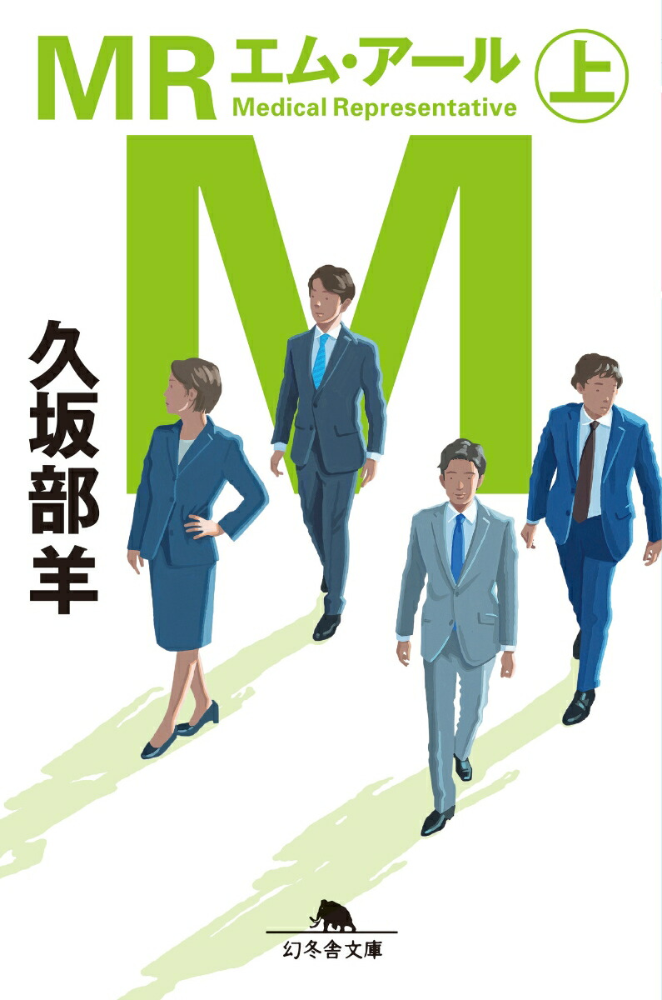
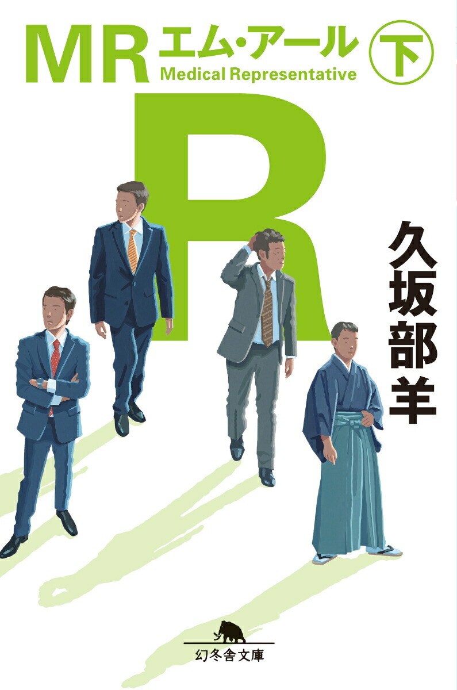

*MR -医薬情報担当者-* is a five-episode WOWOW drama about a pharmaceutical sales rep, starring **Osamu Mukai (向井理)**. It began on **October 4, 2026**, and **episode 1 is free to watch**. It is based on the 2021 novel *MR* (now a two-volume 幻冬舎文庫 paperback) by Yo Hisakabe (久坂部羊), a practising-doctor-turned-novelist known for medical thrillers.

The question the show asks is simple: *is this drug really safe, and who gets to decide?*

Official site: [wowow.co.jp/drama/original/mr](https://www.wowow.co.jp/drama/original/mr/)

## The Short Version

| Item | Details |
|---|---|
| Title | 連続ドラマW **MR -医薬情報担当者-** |
| Broadcast | WOWOW Prime and WOWOW On Demand |
| Premiere | Sunday, **October 4, 2026**, 10 p.m. (JST) |
| Schedule | Episode 2 onward: every Sunday, 10 p.m. |
| Episodes | 5 |
| Episode 1 | **Free** (broadcast and streaming, per [Mynavi News](https://news.mynavi.jp/kikaku/20261004-5046390/)) |
| Original novel | *MR*, Yo Hisakabe (hardcover 2021; 幻冬舎文庫 in two volumes, 2023) |
| Director | Hiroshi Kanai (金井紘) |
| Screenplay | Takashi Kosaka (香坂隆史) |
| Music | jizue |
| Production | WOWOW, The Works |

**A note on YouTube:** the sources I could read (WOWOW's cast page, Mynavi, Realsound) describe the free first episode as a WOWOW broadcast and WOWOW On Demand offer. I did not find a source that mentions YouTube. Some viewers report that episode 1 is also available on YouTube. If you want to watch there, check the official WOWOW channel and WOWOW's site for the current link, since free-viewing windows can end.

## What Is an "MR"?

MR stands for **Medical Representative** (医薬情報担当者). MRs work for drug companies and visit doctors and pharmacists. Their official job is to supply information on a drug's effectiveness and safety, and to collect feedback and side-effect reports from the field and send them back to the company.

The job has a built-in tension. MRs are paid by a company that wants to sell drugs, but they are also a channel for safety information. The drama is built on that tension.

## The Story

*(No spoilers beyond the setup.)*

**Masaki Kionaka (紀尾中正樹, Osamu Mukai)** is an MR and branch manager at the mid-to-large drug maker **Tenpo Pharmaceutical (天保薬品)**. He is known among doctors for putting patients first. The sources say he will even recommend a rival's drug if it works better for the patient, and that he carries a trauma from his past.

His goal is to get Tenpo's new type 2 diabetes drug **"Pansel" (パンセル)** into the clinical practice guidelines at the top recommendation level. A guideline listing is a huge commercial win, because doctors across the country look to guidelines when they prescribe.

Standing in the way is **Jun Samejima (鮫島淳, Jun Kaname)**, an MR at the foreign-owned rival **Taurus (タウロス)**. He is a former classmate of Kionaka's at Tenpo and is driven purely by profit. He is chasing a blockbuster drug of his own, "Gribu" (グリブ), and teams up with an arrogant university professor to push it into the guidelines.

At the same time, trouble builds inside Kionaka's own company. A lung cancer patient's condition suddenly worsens after taking Tenpo's cancer drug **"Novelma" (ノベルマ)**, and concerns about its safety come to light. The risk of a drug-injury lawsuit splits Tenpo internally, and Kionaka has to decide where his loyalty lies: the company, the doctors, or the patients.

Director Hiroshi Kanai has said the series is not just a workplace drama. He describes it as a human drama of clashing justice, beliefs and motives.

## The Original Novel

The source is **Yo Hisakabe's** *MR* (エム・アール, Medical Representative). It first came out as a hardcover from Gentosha in April 2021, and the **Gentosha Bunko** paperback followed on **April 6, 2023**, split into two volumes (上 and 下).

| | Vol. 1 (上) | Vol. 2 (下) |
|---|---|---|
| Cover | {: width="200" alt="MR (上) Gentosha Bunko cover"} | {: width="200" alt="MR (下) Gentosha Bunko cover"} |
| ISBN-13 | 978-4-344-43285-7 | 978-4-344-43286-4 |
| Price | ¥825 (incl. tax) | ¥825 (incl. tax) |
| Buy | [Kinokuniya](https://www.kinokuniya.co.jp/f/dsg-01-9784344432857) | [Kinokuniya](https://www.kinokuniya.co.jp/f/dsg-01-9784344432864) |

Prices and ISBNs are from Rakuten Books' listing ([search page](https://books.rakuten.co.jp/search/?sitem=%E4%B9%85%E5%9D%82%E9%83%A8%E7%BE%8A+MR)); e-book versions are also listed there. The hardcover is ISBN 978-4-344-03763-2. Cover images belong to Gentosha and are shown here to identify the book.

Hisakabe graduated from the Osaka University medical school, worked as a doctor, and has written medical fiction for years. He won the 3rd Japan Medical Novel Prize for *Akui* (悪医). *MR* is a "medical business novel" about both the light and the shadow of the pharmaceutical industry.

Hisakabe has said that pharma dramas are hard to make on commercial TV because of advertising-sponsor concerns, and that he is grateful WOWOW made this one. This is his third WOWOW adaptation, after *Daisan no Misu* and *Kami no Te* (神の手). He also points to a dilemma built into the job: MRs cannot sell directly to patients, and a drug that cures people can mean fewer sales.

## Cast and Characters

| Character | Actor | Role in the story |
|---|---|---|
| Masaki Kionaka (紀尾中正樹) | **Osamu Mukai** (向井理) | Tenpo MR and branch manager; trusted by doctors for putting patients first |
| Jun Samejima (鮫島淳) | **Jun Kaname** (要潤) | Taurus MR; Kionaka's former classmate; purely profit-driven |
| Kazumi Ichihashi (市橋和巳) | **Yoshiki Shomon** (正門良規, Aぇ! group) | Tenpo rookie MR; eager but error-prone, finds a sense of mission watching Kionaka |
| Kazuhiko Isogawa (五十川和彦) | **Kosuke Toyohara** (豊原功補) | Tenpo head of sales; Kionaka's former direct boss |
| Maya Yamada (山田麻弥) | **Rena Takeda** (武田玲奈) | Tenpo MR; outspoken, sharp, resourceful in a crisis |
| Koujiro Yagami (八神功治郎) | **Yoshi Sako** (酒向芳) | Jouhoku University Hospital professor; capable but status-seeking; teams up with Samejima |
| Kang Yeongjin (カン・ヨンジン) | **Ji-young** (知英) | Director of a Korean medical center running Taurus's "Gribu" trial |
| Tetsuko Kuribayashi (栗林哲子) | **Makiko Watanabe** (渡辺真起子) | Tenpo managing director; puts protecting the company first |
| Hajime Inui (乾肇) | **Tsuyoshi Masu** (升毅) | Honorary professor and head of the diabetes society; backs "Pansel" |
| Akihiro Donoue (堂之上彰浩) | **Satoshi Matsuo** (松尾諭) | Doctor trusted by patients; trapped by the schemes |
| Sakiko Yoshino (吉野咲子) | **Sou Morita** (森田想) | Elementary school teacher with lung cancer |
| Teruhisa Yoshino (吉野輝久) | **Yoshihiro Nozoe** (野添義弘) | Sakiko's father; considers suing Tenpo |
| Keiichi Ikeno (池野慶一) | **Junya Kawashima** (川島潤哉) | Tenpo chief MR; strict but caring |
| Kengo Maki (牧健吾) | **Taiomi Sano** (佐野泰臣) | Tenpo MR; his daughter has diabetes and uses Tenpo's drugs |

*Source: WOWOW's official cast page. The page has a "show more" button, so a few cast members may not be listed here. Readings of names are my own romanization, so check the Japanese.*

### What the Cast and Crew Say

- **Osamu Mukai** said many of his university classmates became MRs, which made the offer feel almost fated. He wanted to play a man who rarely shows emotion but has a strong inner passion for the work. His message to viewers: *"MRがいることで多くの命が救われていることも事実です"* ("It is also true that many lives are saved because MRs exist"). The director praised him for memorizing a huge amount of unfamiliar drug terminology. ([Realsound](https://realsound.jp/movie/2026/06/post-2422250.html))
- **Yo Hisakabe** described the MRs as people who fight for patients while putting up with doctors' high-handedness.

## How MRs Affect Society

This section is my own overview of the real-world background, not a claim made by the drama. I have kept it to well-known points.

**1. MRs shape what doctors prescribe.**
Doctors cannot track every new drug, so MRs are a main source of product information. That is useful, but it also means a company's version of the facts reaches prescribers first. One survey of medical staff and drug companies (from a pharma-MR training center) found medical staff mostly want basic information, and some complain about information that is biased toward the company's own products and too strongly sales-driven.

**2. Guidelines are worth a fortune.**
When a drug is recommended in a clinical guideline, prescriptions can rise sharply. This is why the drama makes the guideline the battlefield: it is where science, professional authority and money meet. That raises the question of **conflicts of interest** among the experts who write guidelines and run trials, and why academic societies now require disclosure of ties to drug makers.

**3. Research can be bent by commercial interest.**
Japan has seen real scandals, the best known being the early-2010s cases involving a Novartis blood-pressure drug, in which trial data were found to have been manipulated. They led to tougher rules on clinical research (the Clinical Trials Act, which took effect in 2018) and on promotional activities. The drama's plot of a rival MR asking a doctor to publish a self-serving paper is fiction, but it echoes concerns that were real.

**4. Rules have tightened.**
Japan now has stricter guidelines on drug promotion, limits on entertainment and gifts for doctors, and public disclosure of payments from companies to doctors. The industry's relationship with doctors is much more visible than it was a generation ago.

**5. The patient side.**
MRs are also meant to carry side-effect reports back to the company. When that fails, the cost falls on patients. In the drama, Sakiko Yoshino's sudden deterioration after taking "Novelma" is that scenario made human.

**6. The profession is changing.**
Online detailing, tighter access rules at hospitals, and the shift from broad "blockbuster" drugs to specialist medicines have pushed the industry to rethink what an MR is for. A good MR increasingly means someone who gives accurate, balanced evidence, which is the kind of person Kionaka is written to be.

## Why It Is Worth Watching

- **A rare angle.** As director Kanai notes, MRs are an under-explored job in medical drama. Most shows follow doctors; this one follows the person who stands between the drug company and the doctor.
- **Moral grey zones.** Kionaka, Samejima and the company are not simple heroes and villains. Everyone can justify their actions.
- **A strong ensemble.** Mukai and Kaname in a rivalry, with Toyohara, Masu, Sako and Watanabe in supporting roles.
- **Only five episodes.** Short enough to catch up quickly.

## Where to Watch

1. **Episode 1 (free):** WOWOW broadcast and WOWOW On Demand per the reports above. Check the [official site](https://www.wowow.co.jp/drama/original/mr/) for the latest link, including any YouTube upload.
2. **Episodes 2–5:** WOWOW Prime and WOWOW On Demand (a WOWOW subscription is needed).

## Sources

- [WOWOW official site](https://www.wowow.co.jp/drama/original/mr/): cast and staff
- [Mynavi News, Oct. 4, 2026](https://news.mynavi.jp/kikaku/20261004-5046390/): schedule, free episode 1, story
- [Realsound, June 11, 2026](https://realsound.jp/movie/2026/06/post-2422250.html): comments from Mukai, Hisakabe and Kanai
